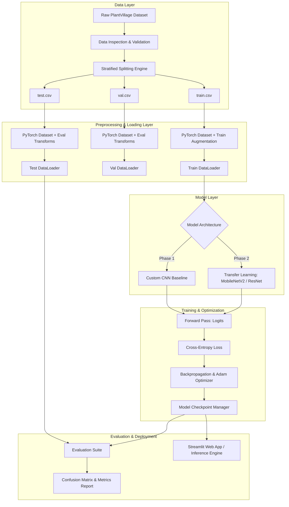

# System Architecture Blueprint

This document outlines the architectural flow of the **Crop Disease Detection** system, from raw image ingestion to user-facing inference.

---

## 🏗️ End-to-End Pipeline

---

## 🧩 Architectural Modules Breakdown

### 1. Data Pipeline (`src/data/`)
- **`download_dataset.py`**: Handles downloading/extracting the PlantVillage repository and filtering specifically for tomato classes.
- **`explore_dataset.py`**: Computes image statistics (dimensions, channels, class distribution, corrupt image detection).
- **`prepare_dataset.py`**: Fully decodes all 18,160 images via `Image.load()`, executes deterministic stratified splits (70% Train, 15% Val, 15% Test with seed 42), verifies zero data leakage, and writes relative-path manifests to `data/splits/train.csv`, `val.csv`, `test.csv`, and `class_mapping.json`.
- **`dataset.py`**: Implements custom PyTorch `Dataset` (`PlantVillageTomatoDataset`) wrapping PIL image loading and torchvision transforms:
  - **Training transforms**: `Resize(224, 224)`, `RandomHorizontalFlip(p=0.5)`, `RandomRotation(15)`, `ToTensor()`, `Normalize(mean=[0.485, 0.456, 0.406], std=[0.229, 0.224, 0.225])`.
  - **Evaluation transforms**: `Resize(224, 224)`, `ToTensor()`, `Normalize(ImageNet)` (strictly deterministic).
  - **DataLoaders**: `create_dataloaders()` with configurable batch size (default 32), `num_workers=0` (Apple Silicon M2 stability), and deterministic ordering on validation/test sets.

### 2. Model Zoo (`src/models/`)
- **`cnn.py` (`BaselineCNN`)**: Custom 3-block Convolutional Neural Network baseline trained from scratch:
  - Input: `(3, 224, 224)` RGB tensor
  - Block 1: `Conv2d(3, 32, kernel_size=3, padding=1)` + `ReLU` + `MaxPool2d(2)` -> `(32, 112, 112)`
  - Block 2: `Conv2d(32, 64, kernel_size=3, padding=1)` + `ReLU` + `MaxPool2d(2)` -> `(64, 56, 56)`
  - Block 3: `Conv2d(64, 128, kernel_size=3, padding=1)` + `ReLU` + `MaxPool2d(2)` -> `(128, 28, 28)`
  - Dimension Safety: `AdaptiveAvgPool2d((4, 4))` -> `(128, 4, 4)`
  - Classifier Head: `Flatten(2048)` -> `Linear(2048, 256)` -> `ReLU` -> `Dropout(0.3)` -> `Linear(256, 10)` -> Raw Logits
  - Total Trainable Parameters: **620,362**
- **`transfer_learning.py` (`ResNet18`)**: Pretrained vision backbone adapted for 10 tomato categories:
  - Input: `(3, 224, 224)` RGB tensor
  - Backbone: Pretrained ImageNet weights (`ResNet18_Weights.DEFAULT`) with residual shortcut skip-connections.
  - Classification Head: Replaces default 1000-class linear head with `nn.Linear(512, 10)` yielding raw logits.
  - Two-Phase Transfer Learning Strategy:
    - **Phase A (Feature Extraction)**: Entire backbone frozen (`requires_grad=False`); only `fc` (5,130 parameters) trained with $LR = 0.001$.
    - **Phase B (Fine-Tuning)**: `layer4` and `fc` unfrozen (~8.4M trainable parameters); lower $LR = 0.0001$ for `layer4` and $LR = 0.001$ for `fc`.
  - Total Parameters: **11,181,642** (Phase A trainable: 5,130; Phase B trainable: 8,401,930).

### 3. Training & Validation Engine (`src/training/`)
- **`train.py`**:
  - Training loop for BaselineCNN from scratch.
  - Checkpoint Management: Automatically writes best model weights to `artifacts/checkpoints/best_baseline_cnn.pt`.
  - History Export: Logs epoch metrics to `reports/baseline_cnn_history.json`.
- **`train_resnet18.py`**:
  - Standalone training pipeline for ResNet18 transfer learning.
  - Executes sequential Phase A (feature extraction) and Phase B (fine-tuning) across configured epochs.
  - Differential learning rates via `Adam` parameter groups.
  - Checkpoint Management: Saves best model to `artifacts/checkpoints/best_resnet18.pt` without altering baseline CNN artifacts.
  - History Export: Logs epoch metrics and phase tags to `reports/resnet18_history.json`.
- **`evaluate.py`**: Evaluates model performance on the holdout test set without gradient tracking (`torch.no_grad()`).

### 4. Metrics & Diagnostics (`src/evaluation/`)
- **`metrics.py`**: Calculates multi-class accuracy, precision, recall, and F1-score (macro and per-class).
- **`plots.py`**: Produces publication-grade confusion matrices and training loss/accuracy history plots.
- **`error_analysis.py`**: Isolates misclassified samples to diagnose whether errors stem from visual ambiguity, illumination, or overlapping symptoms.

### 5. Utility & Reproducibility (`src/utils/`)
- **`device.py`**: Automatically detects Apple Silicon hardware acceleration (`mps`) with graceful CPU fallback.
- **`reproducibility.py`**: Sets identical random seeds across Python, NumPy, and PyTorch (CPU and MPS).
- **`logging_config.py`**: Provides structured standard logging output.

### 6. Interactive Demo (`app/`)
- **`app.py`**: Streamlit interface allowing farmers or judges to upload leaf photos, preview the preprocessed tensor, inspect class probabilities, and review model explanations.

### 7. Mathematical Sandbox (`src/math_sandbox/` — REQ-01)
- **`tensor_ops.py`**: Pure NumPy tensor creation, structural inspection (shape, strides, C-contiguity, memory footprints), inner products (dot, Hadamard, matrix multiplication), and broadcasting mechanics (rank alignment, virtual dimension expansion, and shape mismatch detection).
- **`svd_compression.py`**: Singular Value Decomposition ($A = U \Sigma V^T$) low-rank matrix and RGB image compression based on the Eckart-Young-Mirsky theorem. Computes Frobenius norm error, cumulative energy retention spectra, compression ratios, and PSNR across rank parameters $k \in [5, 20, 50, 100]$.
- **`gradient_checker.py`**: Finite difference numerical gradient verification tools comparing forward difference ($O(h)$) vs central difference ($O(h^2)$) against analytical derivatives, tracking the theoretical truncation error vs floating-point subtractive cancellation trade-off.
- **`run_demonstrations.py`**: Automated end-to-end driver script executing all Phase A demonstrations and generating high-resolution figures in `artifacts/figures/foundations/`.

### 8. Neural Network Fundamentals (`src/neural_fundamentals/` — REQ-02 & REQ-03)
- **`mcculloch_pitts.py`**: Discrete binary threshold neuron (1943) modeling excitatory inputs, inhibitory vetoes, and implementing canonical Boolean logic gates (AND, OR, NOT, NAND, NOR) alongside a formal mathematical proof of single-neuron XOR non-separability.
- **`sigmoid_neuron.py`**: Single continuous artificial neuron with Sigmoid activation, analytical derivative $d\sigma/dz = \sigma(1-\sigma)$, Binary Cross-Entropy loss, and gradient descent optimization.
- **`perceptron.py`**: Rosenblatt's 1958 Perceptron learning algorithm with Novikoff convergence guarantees on linearly separable inputs and cycling failure on non-separable patterns (XOR).
- **`activations.py`**: Comprehensive activation function suite (Step, Sigmoid, Tanh, ReLU, LeakyReLU) with vectorized implementations, exact analytical derivatives, and theoretical comparative properties.
- **`mlp_from_scratch.py`**: Vectorized arbitrary-depth feedforward Multilayer Perceptron implemented entirely in NumPy with manual analytical backpropagation via multivariable matrix chain rule ($dZ, dW, db$), mini-batch gradient descent, explicit parameter vs hyperparameter segregation, and full numerical gradient checking verification achieving relative error $< 10^{-8}$.

### 9. Optimization Dynamics (`src/optimization/` — REQ-04)
- **`gradient_descent.py`**: Batch Gradient Descent, Stochastic Gradient Descent (SGD), and Mini-Batch Gradient Descent implementations benchmarked on convex regression objectives with parameter, loss, update, and sample evaluation tracking.
- **`optimizers.py`**: First-order optimizers implemented from scratch in pure NumPy: Vanilla GD, Polyak Momentum ($v_t = \gamma v_{t-1} + \eta g_t$), Nesterov Accelerated Gradient (lookahead $w - \gamma v$), and Adam with first/second moment tracking and exact bias corrections ($\hat{m}_t, \hat{v}_t$).
- **`learning_rate_experiments.py`**: Empirical analysis of learning rate dynamics (under-damped crawl, stable convergence, oscillatory overshoot, and explosive divergence exceeding the Hessian spectral limit $\eta > 2/\lambda_{\max}$).
- **`loss_landscape.py`**: 2D contour and 3D wireframe loss landscape visualizers on anisotropic valleys ($\kappa = 10$) showing multi-optimizer trajectories and convergence speed comparisons.
- **`run_phase_b_demonstrations.py`**: Automated end-to-end driver script executing all Phase B optimization and regularization experiments.

### 10. Weight Initialization, Normalization & Regularization (`src/regularization/` — REQ-05)
- **`initialization.py`**: Scratch implementations of Zero, Random, Xavier/Glorot ($2/(n_{in}+n_{out})$), and He/Kaiming ($2/n_{in}$) initializations. Simulates signal and gradient variance flow across 6-layer deep networks and demonstrates the zero-symmetry breakdown failure.
- **`normalization.py`**: Pure NumPy implementations of Batch Normalization (`BatchNorm1dNumPy`, normalizing across batch axis 0) and Layer Normalization (`LayerNorm1dNumPy`, normalizing across feature axis 1 per sample), comparing running statistics in eval mode and batch-size sensitivity down to $B=1$.
- **`regularizers.py`**: L1 Regularization (Lasso penalty, subgradient, parameter sparsity induction), L2 Regularization (Weight Decay quadratic shrinkage), and Inverted Dropout ($1/(1-p)$ inverted scaling with train/inference mode toggling).
- **`ablation_studies.py`**: Controlled single-factor ablation benchmark on identical train/validation splits comparing Baseline, L1, L2, Dropout, Training Augmentation, and Initialization strategies. Results exported to `reports/phase_B_ablation_results.json`.

### 11. Classical Learning Paradigms & Energy-Based Models (`src/learning_paradigms/` — REQ-06)
- **`hebbian.py`**:
  - `BasicHebbianLearner`: Unsupervised synaptic weight update rule ($\Delta w = \eta y x$) demonstrating exponential parameter explosion ($\|w\|_2 \approx 10^{12}$ within 1,500 iterations) without homeostatic decay.
  - `OjaLearner`: Synaptically normalized update rule ($\Delta w = \eta y (x - y w)$) providing mathematical stabilization ($\|w\|_2 \to 1.0$) and extracting the true first principal component (eigenvector) of the data covariance matrix with cosine similarity $\ge 0.999$.
- **`competitive.py`**:
  - `CompetitiveLearningWTA`: Winner-Take-All competitive learning for unsupervised vector quantization and multi-cluster centroid convergence.
  - `KohonenSOM`: 2D lattice Self-Organizing Map with Gaussian neighborhood decay ($h_{ci}(t) = \exp(-\|r_c - r_i\|^2 / (2\sigma(t)^2))$), preserving topological relationships when mapping high-dimensional inputs to planar coordinates.
- **`error_correction.py`**:
  - `DeltaRuleLearner`: Supervised Widrow-Hoff LMS / Adaline learning algorithm based on continuous linear output error signals ($\Delta w = \eta (y - \hat{y}) x$), benchmarked against unsupervised Hebbian association on linear decision tasks.
- **`hopfield.py`**:
  - `HopfieldNetwork`: Discrete associative memory network with bipolar states $s \in \{-1, +1\}^N$, Hebbian outer-product weight storage ($W = \frac{1}{N} \sum_p \xi^{(p)} (\xi^{(p)})^T$), enforced symmetric connectivity ($W = W^T$), zero self-connections ($W_{ii} = 0$), and asynchronous updates.
  - **Lyapunov Energy Monotonic Descent**: Rigorous implementation and verification of $E(s) = -\frac{1}{2} s^T W s$, guaranteeing strictly non-increasing energy trajectories ($\Delta E_i = -\Delta s_i h_i \le 0$) and robust pattern recovery from corrupted inputs ($> 95\%$ accuracy).
- **`boltzmann.py`**:
  - `RestrictedBoltzmannMachine` (RBM): Energy-based bipartite graphical model with binary stochastic visible ($v \in \{0, 1\}^D$) and hidden ($h \in \{0, 1\}^K$) units, no intra-layer connections, and exact analytical free energy calculation:
    $$\mathcal{F}(v) = -a^T v - \sum_j \ln(1 + \exp(b_j + W_{:, j}^T v))$$
  - **Contrastive Divergence (CD-1)**: One-step Gibbs sampling ($v_0 \to h_0 \sim P(h|v_0) \to v_1 \sim P(v|h_0) \to h_1 \sim P(h|v_1)$) approximating the gradient of log-likelihood via positive and negative energy phases.
- **`run_phase_c_demonstrations.py`**: Automated end-to-end execution driver for all Phase C experiments, generating 8 publication-grade visualization figures in `artifacts/figures/learning_paradigms/`.

### 12. Multi-Task Vision: Interpretability, Segmentation & Object Detection (`REQ-08`)
- **Model Interpretability (`src/interpretability/`)**:
  - `grad_cam.py`: Gradient-weighted Class Activation Mapping (`GradCAM`) using forward/backward PyTorch hooks on `TomatoResNet18.layer4[-1].conv2`, computing $\alpha_k = \text{GAP}(\partial y^c / \partial A^k)$ and class-discriminative saliency maps $L_{\text{Grad-CAM}}^c = \operatorname{ReLU}(\sum_k \alpha_k A^k)$.
  - `visualization.py` & `run_gradcam.py`: Heatmaps overlaid onto RGB leaf images and exported to `artifacts/figures/interpretability/`.
- **Convolution & Feature Map Extraction (`src/visualization/`)**:
  - `convolution_visualizer.py`: Pure NumPy 2D discrete spatial convolution $Y(i, j) = \sum_m \sum_n X_{\text{pad}}(i \cdot s + m, j \cdot s + n) K(m, n)$ verifying Sobel X/Y, Laplacian, Gaussian, Sharpening, and Ridge kernels with exact numerical parity against PyTorch.
  - `feature_maps.py` & `run_visualizations.py`: Forward-hook extractor capturing activations across all 5 ResNet18 stages (`conv1`, `layer1`, `layer2`, `layer3`, `layer4`).
- **U-Net Semantic Segmentation (`src/segmentation/`)**:
  - `unet.py`: Full Encoder-Bottleneck-Decoder U-Net from scratch with `DoubleConv`, `MaxPool2d`, skip connection concatenation, and $1 \times 1$ pixel-logit projection.
  - `losses_metrics.py`: Multi-class `DiceLoss`, `CombinedLoss` (CE + Dice), mIoU, per-class IoU, Dice coefficients, and pixel accuracy.
  - `dataset.py`, `train.py`, `evaluate.py`, `visualization.py`: Paired image-mask pipeline enforcing nearest-neighbor categorical interpolation, independent checkpointing (`artifacts/checkpoints/segmentation/best_unet.pt`), and 4-panel visual evaluations (`artifacts/figures/segmentation/`).
- **Pest Object Detection (`src/detection/`)**:
  - `boxes.py` & `metrics.py`: Coordinate geometry (`[xmin, ymin, xmax, ymax]` $\leftrightarrow$ `[cx, cy, w, h]`), boundary clipping, IoU matrix, Non-Maximum Suppression (NMS), and COCO-compatible mAP@0.5 / mAP@0.5:0.95 computation.
  - `dataset.py`: Parsers for YOLO `.txt` and Pascal VOC `.xml` bounding-box formats alongside synthetic pest benchmark generator.
  - `model.py`, `train.py`, `evaluate.py`, `visualization.py`: Single-stage grid detector (`TinyYOLODetector`), SSDLite MobileNetV3 factory, independent checkpointing (`artifacts/checkpoints/detection/best_pest_detector.pt`), and bounding-box overlays (`artifacts/figures/detection/`).

### 13. Temporal Disease Progression & Generative Modeling (`REQ-09`)
- **Temporal & Sequence Modeling (`src/temporal/`)**:
  - `rnn_from_scratch.py` & `lstm_from_scratch.py`: Pure NumPy forward-pass implementations (`VanillaRNNNumPy`, `LSTMCellNumPy`) demonstrating hidden/cell state updates and Forget/Input/Output gates with exact numerical parity ($< 10^{-5}$) against PyTorch.
  - `sequence_generator.py` & `sequence_dataset.py`: Reproducible synthetic longitudinal disease progression benchmark (Healthy/Stable, Linear Spread, Logistic Outbreak, Treatment Recovery) strictly isolated by `plant_id` across Train (420), Validation (90), and Test (90) splits.
  - `temporal_model.py`, `train.py`, `evaluate.py`, `visualization.py`, `run_temporal_demonstrations.py`: PyTorch `VanillaRNNRegressor` and `LSTMRegressor` with internal state/gate trace extraction, independent checkpoints (`artifacts/checkpoints/temporal/`), and plots in `artifacts/figures/temporal/`.
- **Generative Deep Learning (`src/generative/`)**:
  - `vae_dataset.py`: Balanced 64x64 RGB subset loader reading strictly from `data/splits/train.csv` and `data/splits/val.csv` (forbidding access to `test.csv`).
  - `vae.py`, `train_vae.py`, `evaluate_vae.py`: Convolutional Variational Autoencoder (`ConvVAE`) implementing differentiable reparameterization ($z = \mu + \sigma \odot \epsilon$) and $\beta$-ELBO loss ($\mathcal{L}_{\text{recon}} + \beta \mathcal{L}_{\text{KL}}$), checkpointed to `artifacts/checkpoints/generative/best_vae.pt`.
  - `latent_analysis.py`: Deterministic latent embedding extraction, 2D PCA Healthy vs Diseased manifold visualization, and linear latent interpolation.
  - `gan.py` & `train_gan.py`: Lightweight Deep Convolutional GAN (`DCGANGenerator`, `DCGANDiscriminator`) trained via alternating minimax optimization with one-sided label smoothing and fixed-noise monitoring (`artifacts/checkpoints/generative/dcgan_checkpoint.pt`).
  - `visualization.py` & `run_generative_demonstrations.py`: Exports training curves, reconstructions, prior samples, PCA manifold plots, and DCGAN outputs to `artifacts/figures/generative/`.

### 14. Model Calibration, Robustness Testing & Final Synthesis (`REQ-10`)
- **Classification Model Calibration (`src/calibration/`)**:
  - `calibration_metrics.py`: Computes Expected Calibration Error (ECE), Maximum Calibration Error (MCE), Multi-class Brier score, Negative Log-Likelihood (NLL), and bin-level reliability statistics across $M=15$ confidence bins.
  - `temperature_scaling.py`: Post-hoc probability calibration (`ModelWithTemperature`, `TemperatureScaler`) fitting scalar $T > 0$ strictly on validation logits via L-BFGS with strong Wolfe line search. Optimal $T^* = 1.3021$ achieves a 26.2% ECE reduction on the holdout test set (from 0.493% to 0.364%) while preserving 100% of classification accuracy.
  - `reliability_diagram.py` & `run_calibration.py`: Reliability diagrams and confidence histograms saved to `artifacts/figures/calibration/`, metadata saved to `artifacts/checkpoints/temperature_scale.json`.
- **Environmental & Adversarial Robustness (`src/robustness/`)**:
  - `corruptions.py`: Systematic benchmark of 8 realistic agricultural corruption modes across 3 severities: Gaussian Noise, Gaussian Blur, Motion Blur, Brightness Up, Brightness Down, Contrast Reduction, JPEG Compression, and Spatial Resolution Reduction.
  - `adversarial_tests.py`: Fast Gradient Sign Method (FGSM) evaluating perturbation budgets $\epsilon \in [0.0, 0.005, 0.01, 0.02, 0.05]$ in pixel space.
  - `robustness_evaluation.py` & `run_robustness_tests.py`: Generates degradation curves, visual comparison panels, and tabular outputs in `reports/final_robustness_results.csv` and `artifacts/figures/robustness/`.
- **Inference Latency & Memory Profiling (`src/profiling/`)**:
  - `latency_profiler.py`: High-precision micro-benchmarks with device synchronization (`torch.mps.synchronize` / `torch.cuda.synchronize`), warm-up runs, and percentile reporting (P50, P95, mean latency, throughput FPS) across batch sizes $B \in \{1, 4, 8, 16\}$.
  - `memory_profiler.py`: Parameter counting (trainable vs non-trainable), FP32 tensor allocation, forward activation memory hooks, and disk checkpoint footprint.
  - `run_profiling.py`: Exports comparative curves and CSVs to `reports/final_latency_benchmark.csv` and `reports/final_memory_profile.csv`.
- **Comprehensive Holdout Error Analysis (`src/final_evaluation/`)**:
  - `error_analysis.py` & `run_final_evaluation.py`: Full holdout test evaluation ($N=2,724$), normalized and raw confusion matrices, top confused pairs identification, and high-confidence error cataloging exported to `reports/final_error_analysis.csv` and `reports/final_per_class_metrics.csv`.

### 15. Real-World Tomato Surveillance & Field-Video Pipeline (Phase G)
- **Real Tomato Pest Detection (`src/detection/`)**:
  - `real_pest_dataset.py`: Verified data loader for Shehu et al. (2025) *Frontiers in Plant Science* / Zenodo `13324917` under CC BY 4.0. Parses normalized YOLO format for real *Tuta absoluta* (Tomato Leafminer) field damage across 122 images (98 train, 12 val, 12 test) with 319 human-annotated bounding boxes.
  - `train_yolov8_seg.py` & `evaluate_yolov8_seg.py`: Trains and evaluates the production YOLOv8n-Seg multi-class instance segmentation network (`best_yolov8n_seg.pt`) on real *Tuta absoluta* mines and healthy foliage references. Preserves the legacy baseline checkpoint (`artifacts/checkpoints/pest_detection_real/best_pest_detector_real.pt`) for benchmark comparison.
- **Video Surveillance Pipeline (`src/surveillance/`)**:
  - `video_processor.py`: Video container decoding (.mp4, .avi), strict safety boundaries ($<60$s duration, $<100$MB file size), metadata extraction, and temporal stride sampling.
  - `frame_analyzer.py`: Multi-task inference engine uniting calibrated `TomatoResNet18` ($T^* = 1.3021$) across 10 tomato diseases with the trained real *Tuta absoluta* pest detector.
  - `annotator.py`: Professional heads-up display overlay rendering telemetry banner, diagnosis card, confidence meter, pest counter, and bounding boxes.
  - `timeline_plotter.py`: Dual-axis temporal analytics graphing disease class probabilities and pest counts over surveillance time.
  - `video_generator.py`: Generates realistic field surveillance video sequences from real tomato leaf and pest photography for offline verification.
  - `run_video_surveillance.py`: End-to-end runner generating `annotated_surveillance.mp4`, `reports/video_surveillance_frames.csv`, `artifacts/figures/video/disease_timeline.png`, and `reports/video_surveillance_summary.json` at 37.5 FPS.
- **Lesion Segmentation Audit & Declaration**:
  - Formal academic audit documenting candidate segmentation sets and declaring Milestone G3 **BLOCKED BY DATASET AVAILABILITY** per user non-negotiable rules. Preserves the Phase D U-Net architecture (`src/segmentation/`).

